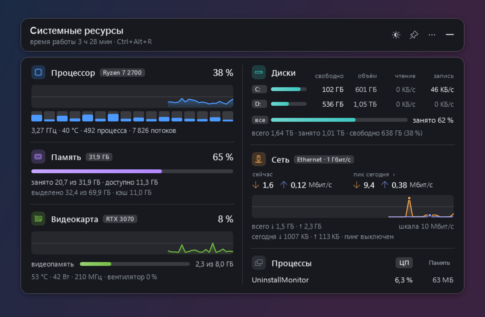
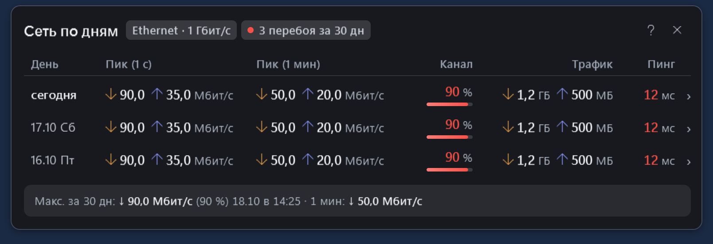
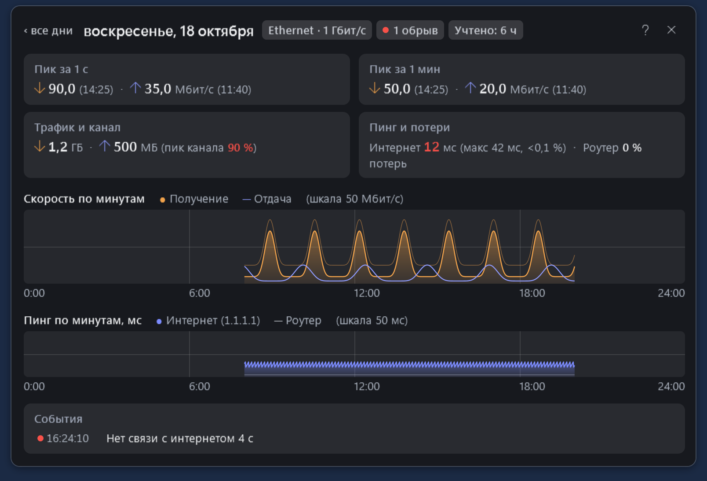
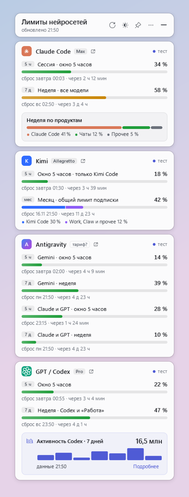

# Desktop Widgets

[Русский](README.ru.md) · [Project page](https://nikolaykazakovvs-ux.github.io/desktop-widgets/) · [AI Limits 1.1 guide](docs/limits-widget.md) · [Download v0.2.0 / v0.1.1](https://github.com/nikolaykazakovvs-ux/desktop-widgets/releases)

Two independent Windows widgets. **System Resources** monitors your computer and keeps a detailed network journal. **AI Limits** shows subscription usage windows, reset times, credits and token activity. Use either on its own. Native C# and Windows Presentation Foundation (WPF); the application interface is currently Russian.

## Download and run

Public prerelease collection: **v0.2.0** (AI Limits 1.1.0) and **v0.1.1** (System Resources 1.1.1). Requirements: **Windows 10/11 x64 and .NET Framework 4.8**. macOS and Linux are planned separately; neither has an implementation or download yet.

| Application | Download | Start |
| --- | --- | --- |
| System Resources 1.1.1 | [Windows installer](https://github.com/nikolaykazakovvs-ux/desktop-widgets/releases/download/v0.1.1/ResourcesWidgetSetup-1.1.1-x64.exe) | Open the installer; it shows the card after installation |
| System Resources 1.1.1 | [Portable ZIP](https://github.com/nikolaykazakovvs-ux/desktop-widgets/releases/download/v0.1.1/ResourcesWidget-1.1.1-win-x64.zip) | Extract to a writable folder and open ResourcesWidget.exe |
| AI Limits 1.1.0 | [ZIP (v0.2.0)](https://github.com/nikolaykazakovvs-ux/desktop-widgets/releases/download/v0.2.0/LimitsWidget-1.1.0-win-x64.zip) | Extract to a writable folder (or update via `update-limits-widget.ps1`), open LimitsWidget.exe, then enable the sources you need |

[AI Limits v0.2.0 release notes and SHA-256 checksums](https://github.com/nikolaykazakovvs-ux/desktop-widgets/releases/tag/v0.2.0) · [System Resources v0.1.1 release notes and SHA-256 checksums](https://github.com/nikolaykazakovvs-ux/desktop-widgets/releases/tag/v0.1.1). Applications and installer are unsigned; Windows may warn about an unknown publisher. Follow your organisation's policies on managed computers.

The resources installer installs for the current user into a new/empty dedicated folder or a verified existing installation, adds shortcuts and an uninstall entry, and preserves configuration and window state on upgrade. **Startup and the local temperature sensor are opt-in.** Uninstall removes known application binaries while preserving settings, network history and unrelated files.

The optional checkbox “Локальный датчик температуры процессора (с драйвером PawnIO)” installs a separate local helper with normal Windows administrator approval. It can also be added later through “Установить локальный датчик температуры…” in the tray menu. The main widget runs as a regular user. The helper reads CPU sensors directly through the LibreHardwareMonitor library and exports a protected local file; it opens no network listener and starts no web server. Existing external LibreHardwareMonitor installations are left untouched. Widget uninstall offers helper removal separately; the shared PawnIO driver is retained. [Design and verification boundaries](docs/sensor-security.md).

Click the tray icon to show or hide a card. Default hotkeys: **Ctrl+Alt+R** for resources, **Ctrl+Alt+L** for limits. Tray menus offer themes, scale, opacity, pinning, startup and exit. First launch does not automatically enable Windows startup or change tray icon visibility. Data is stored beside the application, so ZIP distributions need a writable folder. Another copy may show an already-running instance of the same widget.

## System Resources

For work and home computers, including investigating bottlenecks on older PCs:

- **CPU:** overall and per-logical-processor activity, history, frequency, temperature when a sensor is available, process/thread counts.
- **Memory:** used, available, committed and cached.
- **GPU:** load, video memory and available temperature, power, clock and fan readings.
- **Disks:** used/free capacity, reads/writes per drive and combined totals.
- **Processes:** leading CPU or memory users, grouped by executable name.
- **Network:** current speed, peaks, ping, link speed, daily traffic and connection events.

[](docs/images/resources-card.png)

Actual application interface and system readings; additional sensors depend on hardware and configuration. Click for full size.

### Network journal

Click the peaks in the card to open daily history. Each day shows a short-interval peak, the highest one-minute average, timestamps, percentage of configured capacity, traffic and average latency. Open a day for minute-by-minute speed and router/external-host ping graphs, losses, observed time and events:

- adapter link-speed changes, such as 1 Gbps to 100 Mbps;
- adapter disconnects;
- repeated external-host nonresponses, compared with router replies;
- sustained high latency.

| Daily journal | Day details |
| --- | --- |
| [](docs/images/network-journal.png) | [](docs/images/network-day.png) |

Actual application interface; controlled, anonymised demo data. Local network-log files contain daily summaries, minute CSV files and events, retained for up to 400 days.

**Measurement boundaries.** The journal observes this computer while the widget runs, including local network traffic; it does not meter every device at home. The short peak depends on the sampling interval (about one second by default); the minute peak uses a rolling average of approximately 60 seconds. Capacity percentage uses the configured plan speed or adapter link speed, not a test of available Internet bandwidth. It helps describe observed load but cannot alone determine the right Internet plan.

External ping defaults to **1.1.1.1**, the router is discovered automatically, and the interval is two seconds. Empty pingHost disables probes. Internet Control Message Protocol (ICMP) replies can be filtered or rate-limited. Router/external comparisons help investigation but do not conclusively identify the provider, router or cable as the cause.

GPU readings use NVIDIA's driver interface and Windows Display Driver Model (WDDM) statistics. CPU temperature can come from the opt-in local helper. Its file is accepted only with valid data no older than five seconds; otherwise temperature remains unavailable or another available source is used.

Existing HWiNFO, AIDA64, Core Temp and LibreHardwareMonitor integrations remain available. A separate HTTP client can read an independently configured external LibreHardwareMonitor at 127.0.0.1:8085; it never starts or configures that server. The bundled local helper does not use HTTP. Empty lhmUrl disables only external LibreHardwareMonitor polling. Sensor availability depends on hardware and driver support.

The WDDM path has been checked on an NVIDIA RTX 3070; AMD and Intel have not been separately tested on real hardware. There is no verified older-PC compatibility or overhead matrix. Assess the widget and optional helper on the intended computer. [Comparison with other tools](docs/comparison.md).

On 18 October 2026, the optional helper was installed on a real Windows host using ordinary administrator consent and an already installed shared PawnIO driver. A normal user read a real CPU temperature from the native local source; writes to the helper, library and snapshot were denied. The helper had no TCP/UDP endpoints. The native source expired after stopping it; restart, upgrade and removal passed while external LibreHardwareMonitor and the shared driver remained intact. A fresh driver installation and a clean-machine hardware matrix were not tested.

## AI Limits

Claude Code, Kimi Code, Antigravity and GPT / Codex in one card: available usage windows, reset times, credits, extra usage and 7-day Codex token activity when a source returns them. Each provider header displays the service icon and title, a subscription badge with provenance tooltip (`manual > confirmed provider field > unknown`), separate quota (`url`) and verified account/billing (`profileUrl`) links with copy support, and observation status/time. A failed refresh retains a previous valid snapshot marked stale (`lastGood` is tracked separately from `latestAttempt`). Missing data is never interpreted as zero usage.

[](docs/images/limits-card.png)

Actual application interface; demo data. No personal account snapshot is shown.

**All providers are disabled by default**, including when configuration is absent. Enabled providers refresh automatically (default 300 seconds, minimum 60) and publish results to the card and local telemetry as each provider completes. Sign in through the installed provider application or command-line interface (CLI), then enable the required sources via the native **“Подписки…” (Subscriptions)** dialog in the menu or `services.<provider>.enabled` in local `config.json`. An optional `command` field selects the installed CLI. Do not put credentials in configuration. See the [AI Limits 1.1 guide and reversible update instructions](docs/limits-widget.md).

| Provider | Implemented source, plan provenance and links |
| --- | --- |
| Claude Code | Installed `claude` CLI: streaming `get_usage` request with `/usage` fallback. If CLI authentication is missing, may read the Claude desktop application's local usage cache. Model-scoped weekly windows keep confirmed adapter pool identity; missing `utilization` stays unknown rather than `0%`. Default links: usage `https://claude.ai/settings/usage`, billing `https://claude.ai/settings/billing`. Plan label is manual unless a confirmed provider field is present. |
| GPT / Codex | `codex app-server`: subscription windows via `account/rateLimits/read` (including automatic `planType` when reported) and optional account-wide 7-day token activity via `account/usage/read` on the same process (daily buckets plus expandable `lifetimeTokens`, `peakDailyTokens`, `currentStreakDays`, `longestStreakDays`, `longestRunningTurnSec`, kept separate from quota telemetry). Default links: usage `https://chatgpt.com/codex/settings/usage`, account `https://chatgpt.com/#settings/Account`. |
| Antigravity | `agy /usage` for quota windows and decoupled `/credits` check (separate 15-minute cache and 10-second timeout). Default subscriptions link: `https://myaccount.google.com/payments-and-subscriptions`. Plan label is manual unless a confirmed provider field is present. |
| Kimi Code | Probes live local loopback servers from Kimi's instance registry first, with bounded fallback across candidates. When enabled and no usable server responds, can start an owned headless `kimi web --no-open` server without a browser or console window (foreign servers are never stopped; the widget's own server tree stops on widget exit). `userLevelName` is shown as level, not payment proof. Enabling `allowLocalTokens` permits an opt-in OAuth access-token fallback to `baseUrl`; native `kimi` owns authentication and token renewal. |

`allowLocalTokens` controls only Kimi's direct fallback, not all authentication access. It is disabled (`false`) in the distribution. Do not use an untrusted `baseUrl`: the direct fallback sends its bearer token there. For existing installations, `scripts/update-limits-widget.ps1` (also bundled in the ZIP) validates archive SHA-256 (`-ExpectedPackageSha256` or adjacent `SHA256SUMS.txt`), `package-manifest.json` and per-file SHA-256 checksums before mutation, requests graceful-only shutdown of the exact target `LimitsWidget.exe` (aborting before mutation if graceful exit cannot be confirmed, without forced kills or touching foreign processes), preserves `config.json` and `state.json` (including unknown fields), safely archives legacy `src/` and `build.ps1`, and supports `-DryRun` and `-RollbackFromBackup`. Provider application compatibility can change; this is an independent project.

## Data and privacy

Settings, snapshots and journals stay beside the applications. AI Limits 1.1.0 also publishes a private `%LOCALAPPDATA%\DesktopWidgets\telemetry\quotas-snapshot.json` (contract 1.0.0, current user only); the Resources source on `main` adds `hardware-snapshot.json` there, which the released Resources 1.1.1 does not include yet. Resources probes its configured ping host, reads the protected local sensor file and can query independently configured external sensors; limits queries explicitly enabled sources. Exports can include device/process/adapter names, paths and activity history. Inspect and redact before sharing. Personal configuration, account data and logs are excluded from the repository and public archives.

The project page is static HTML, without analytics, account queries or external fonts. It uses actual WPF exports: real system readings for resources and controlled demo data for network history and limits.

## Widgets Bridge

The widgets publish private local snapshots in `%LOCALAPPDATA%\DesktopWidgets\telemetry` (contract 1.0.0; the optional `api_limits` extension is described in the contract documents). **Widgets Bridge** (`widgets-bridge`, source in `telemetry/`) reads these snapshots, checks the contract and freshness, and gives verified facts to AI agents through the command line (`widgets-bridge facts --json`) or MCP (Model Context Protocol). It only reads published snapshots: it does not query providers or the system and does not choose executors. It is installed from `telemetry/packaging` (`Install-Bridge.ps1`; the optional `-RegisterClients` flag adds the MCP server to detected clients: Claude Code, Codex, Kimi Code, Antigravity); see the [installation guide](docs/ai-telemetry-installation.md). It is not part of the prebuilt releases yet; installation has been verified in an isolated directory only.

## Developers

Sources: windows/resources-widget and windows/limits-widget. docs is a standalone GitHub Pages site, without a build step. Builds require Windows PowerShell and the .NET Framework 4.8 compiler; no separate .NET SDK is required.

Run in Windows PowerShell from the repository root; intended for developers or the Codex agent:

```powershell
powershell -NoProfile -ExecutionPolicy Bypass -File .\windows\resources-widget\build.ps1
powershell -NoProfile -ExecutionPolicy Bypass -File .\windows\limits-widget\build.ps1
powershell -NoProfile -ExecutionPolicy Bypass -File .\windows\resources-widget\installer\build-setup.ps1
powershell -NoProfile -ExecutionPolicy Bypass -File .\scripts\build-limits-release.ps1 -OutputDirectory .\artifacts\limits-release
powershell -NoProfile -ExecutionPolicy Bypass -File .\scripts\test-limits-release.ps1 -ArtifactsDirectory .\artifacts\limits-release -ResultsDirectory .\artifacts\limits-test-results
```

Application build scripts do not stop a running widget or overwrite existing config.json. Building the installer with its helper requires pinned LibreHardwareMonitor dependencies and the official signed PawnIO installer; preserve their checksums and redistribution notices. Do not query personal accounts during ordinary automated checks. See [contribution guidance](CONTRIBUTING.md).

## Licenses

Project code: [MIT](LICENSE), Copyright (c) 2026 Svetomir. The LibreHardwareMonitor library and PawnIO installer retain their own redistribution terms: [THIRD-PARTY.txt](windows/resources-widget/installer/payload/THIRD-PARTY.txt). Project licensing does not replace dependency terms. No provider affiliation or endorsement is implied.
