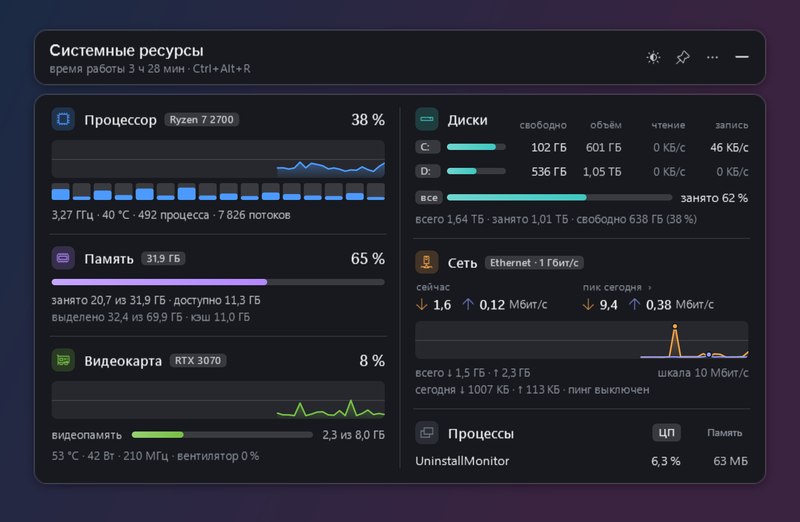
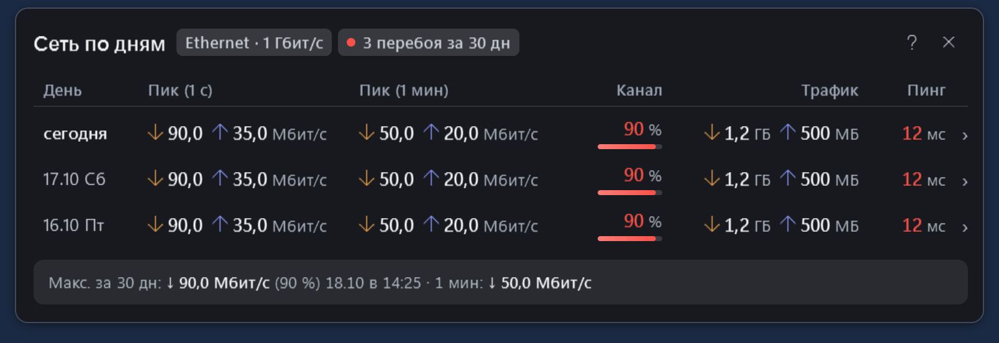
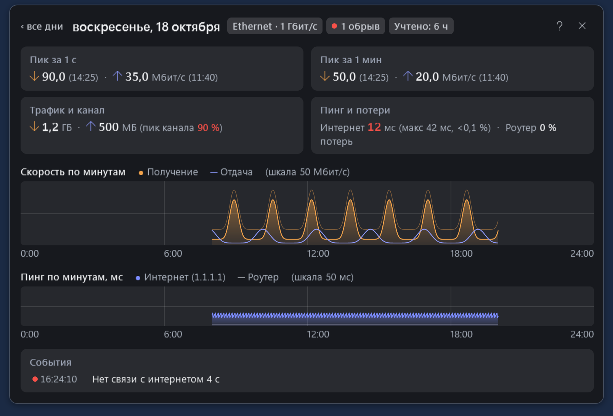
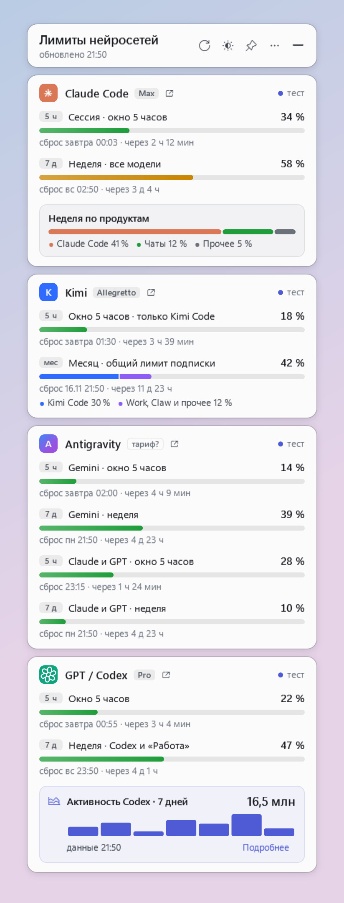

# Виджеты рабочего стола

[English](README.md) · [Страница проекта](https://nikolaykazakovvs-ux.github.io/desktop-widgets/) · [Руководство по Лимитам 1.1](docs/limits-widget.md) · [Скачать v0.2.0 / v0.1.1](https://github.com/nikolaykazakovvs-ux/desktop-widgets/releases)

Два самостоятельных виджета для Windows. **«Системные ресурсы»** показывает компьютер и ведёт подробный журнал сети. **«Лимиты нейросетей»** показывает запас подписок, время сброса, кредиты и статистику токенов. Их можно использовать независимо. Приложения написаны на C# с Windows Presentation Foundation (WPF); интерфейс сейчас на русском.

## Скачать и запустить

Публичные выпуски коллекции: пререлиз **v0.2.0** («Лимиты нейросетей» 1.1.0) и **v0.1.1** («Системные ресурсы» 1.1.1). Требования: **Windows 10/11 x64 и .NET Framework 4.8**. macOS и Linux планируются отдельно; исходников и загрузок для них пока нет.

| Приложение | Загрузка | Как начать |
| --- | --- | --- |
| Системные ресурсы 1.1.1 | [Установщик .exe](https://github.com/nikolaykazakovvs-ux/desktop-widgets/releases/download/v0.1.1/ResourcesWidgetSetup-1.1.1-x64.exe) | Откройте установщик; после установки появится карточка |
| Системные ресурсы 1.1.1 | [ZIP без установки](https://github.com/nikolaykazakovvs-ux/desktop-widgets/releases/download/v0.1.1/ResourcesWidget-1.1.1-win-x64.zip) | Распакуйте в папку с правом записи и откройте ResourcesWidget.exe |
| Лимиты нейросетей 1.1.0 | [ZIP (v0.2.0)](https://github.com/nikolaykazakovvs-ux/desktop-widgets/releases/download/v0.2.0/LimitsWidget-1.1.0-win-x64.zip) | Распакуйте в папку с правом записи (или обновите через `update-limits-widget.ps1`), откройте LimitsWidget.exe и включите нужные источники |

[Пререлиз v0.2.0 (Лимиты 1.1.0) и контрольные суммы SHA-256](https://github.com/nikolaykazakovvs-ux/desktop-widgets/releases/tag/v0.2.0) · [Релиз v0.1.1 (Системные ресурсы 1.1.1) и контрольные суммы SHA-256](https://github.com/nikolaykazakovvs-ux/desktop-widgets/releases/tag/v0.1.1). Приложения и установщик не подписаны: Windows может предупредить о неизвестном издателе. На управляемых компьютерах действуют правила организации.

Установщик ресурсов работает для текущего пользователя: принимает отдельную новую/пустую папку или подтверждённую прежнюю установку, создаёт ярлыки и запись для удаления. **Автозапуск и локальный датчик температуры включаются по выбору.** Обновление сохраняет настройки и положение окна. Удаление убирает известные файлы приложения, сохраняя настройки, сетевой журнал и посторонние файлы.

Галочка «Локальный датчик температуры процессора (с драйвером PawnIO)» устанавливает отдельный локальный помощник с обычным подтверждением администратора Windows. Позже он доступен через меню виджета «Установить локальный датчик температуры…». Основной виджет продолжает работать без повышенных прав. Помощник читает только датчики процессора через библиотеку LibreHardwareMonitor и передаёт результат через защищённый локальный файл: он не открывает сетевой порт и не запускает веб-сервер. Уже установленный внешний LibreHardwareMonitor не изменяется. При удалении виджета помощник предлагается удалить отдельно; общий драйвер PawnIO сохраняется. [Устройство и границы проверки](docs/sensor-security.md).

Щелчок по значку в трее показывает и скрывает карточку. **Ctrl+Alt+R** — ресурсы, **Ctrl+Alt+L** — лимиты. В меню — темы, масштаб, прозрачность, закрепление, автозапуск и выход. Первый запуск не меняет видимость значка Windows и не включает автозапуск автоматически. Настройки и история пишутся рядом с приложением; для ZIP нужна доступная для записи папка. Повторный запуск может показать уже работающую копию того же виджета.

## Системные ресурсы

Для рабочего и домашнего ПК, в том числе поиска узких мест на старых машинах. Карточка показывает:

- **Процессор:** общую загрузку, каждый логический процессор, график, частоту и температуру при доступном датчике; число процессов и потоков.
- **Память:** занято, доступно, выделено, кэш.
- **Видеокарту:** загрузку, видеопамять и доступные показатели температуры, мощности, частоты и вентилятора.
- **Диски:** место, чтение и запись по дискам, общий итог.
- **Процессы:** самые нагруженные по процессору или памяти, с объединением одинаковых имён.
- **Сеть:** текущие скорости, пики, пинг, скорость соединения, дневной трафик и события.

[](docs/images/resources-card.png)

Реальный интерфейс и показания системы; дополнительные датчики зависят от оборудования и настройки. Нажмите на изображение для полного размера.

### Журнал сети

Щелчок по пикам открывает отдельное окно с днями. Для каждого дня: **краткий пик**, **максимум средней за минуту**, время пиков, процент номинала канала, трафик и средняя задержка. Подробности дня показывают поминутные графики скорости и пинга до внешнего узла и роутера, потери, время наблюдения и события:

- изменение скорости соединения адаптера, например 1 Гбит/с → 100 Мбит/с;
- отключение адаптера;
- несколько неответов внешнего узла с сопоставлением ответов роутера;
- длительный высокий пинг.

| Журнал по дням | Подробности дня |
| --- | --- |
| [](docs/images/network-journal.png) | [](docs/images/network-day.png) |

Реальный интерфейс приложения; демонстрационные обезличенные данные. История хранится локально в network-log: итоги по дням, поминутные CSV и события, до 400 дней.

**Границы измерений.** Учитывается этот ПК во время работы виджета, включая локальный сетевой обмен. Трафик других устройств не учитывается. Краткий пик зависит от интервала опроса (по умолчанию около секунды), минутный — максимум скользящей средней примерно за 60 секунд. Процент считается от заданного тарифа либо скорости адаптера и не измеряет доступную пропускную способность интернета. Он помогает оценивать наблюдаемую нагрузку, но сам по себе не определяет подходящий тариф.

Проверка связи включена: внешний узел по умолчанию **1.1.1.1**, шлюз определяется автоматически, интервал — 2 секунды. Пустой pingHost выключает проверки. Пинг использует Internet Control Message Protocol (ICMP); неответ может означать фильтрацию или ограничение ответов. Сравнение с роутером помогает диагностике, но не доказывает виновность провайдера, кабеля или роутера.

**Датчики и совместимость.** Для NVIDIA используется драйвер NVIDIA, для других GPU и запасного пути — Windows Display Driver Model (WDDM). Температуру процессора может отдавать собственный локальный помощник, устанавливаемый по выбору. Значение из его файла принимается только при корректном формате и возрасте не более пяти секунд; недоступный датчик показан прочерком либо используется другой доступный источник.

Сохранены интеграции с HWiNFO, AIDA64, Core Temp и LibreHardwareMonitor. Отдельный HTTP-клиент может читать уже настроенный внешний LibreHardwareMonitor на 127.0.0.1:8085; сам сервер он не запускает и не настраивает. Собственный помощник этот HTTP-путь не использует. Пустой lhmUrl отключает только опрос внешнего LibreHardwareMonitor. В зависимости от оборудования и драйвера часть датчиков может быть недоступна.

Проверка пути WDDM выполнена на NVIDIA RTX 3070; AMD и Intel на реальном оборудовании отдельно не проверялись. Проверенной матрицы старых ПК нет: потребление памяти, CPU и температурного помощника нужно оценивать на целевой машине. [Сравнение с другими программами](docs/comparison.md).

18 октября 2026 года помощник проверен на реальном Windows-компьютере с обычным подтверждением администратора и уже установленным общим PawnIO. Виджет без повышенных прав прочитал реальную температуру именно из нового локального источника; запись в помощник, библиотеку и снимок обычному пользователю запрещена. У помощника не было TCP/UDP-портов. После остановки источник устарел; повторный запуск, обновление и удаление прошли, внешний LibreHardwareMonitor и общий драйвер сохранились. Чистая установка драйвера и матрица оборудования на новых компьютерах не проверялись.

## Лимиты нейросетей

Отдельная карточка Claude Code, Kimi Code, Antigravity и GPT / Codex: доступные окна лимитов, время сброса, кредиты, дополнительный расход и 7-дневная статистика токенов Codex, когда источник их возвращает. В шапке каждой карточки показаны значок и название сервиса, бейдж подписки с подсказкой об источнике (`вручную > подтверждённое поле провайдера > неизвестно`), отдельные ссылки на страницу лимитов (`url`) и страницу аккаунта/оплаты (`profileUrl`) с поддержкой копирования, а также статус и время наблюдения. Предыдущий успешный снимок показывается как устаревший после ошибки (`cache` хранится отдельно от `attempts`). Отсутствующие данные никогда не превращаются в нулевой расход.

[](docs/images/limits-card.png)

Реальный интерфейс приложения; демонстрационные данные. Личные аккаунты на снимке не используются.

**Все провайдеры выключены по умолчанию**, в том числе при отсутствии конфига. После включения выбранный источник обновляется автоматически (по умолчанию раз в 300 секунд, минимум — 60 секунд) и публикует результат в карточку и локальную телеметрию сразу по завершении своего опроса. Войдите штатно через нужное приложение или интерфейс командной строки (CLI), затем включите нужные источники через нативный диалог **«Подписки…»** в меню виджета или через `services.<provider>.enabled` в локальном `config.json`. Необязательный `command` задаёт путь к установленной команде CLI. Секреты в конфиг не записываются. Подробности и команды обновления — в [руководстве по Лимитам 1.1](docs/limits-widget.md).

| Провайдер | Реализованный источник, определение тарифа и ссылки |
| --- | --- |
| Claude Code | Установленный `claude`: `get_usage` в потоковом режиме, запасной `/usage`. При отсутствии входа CLI может читать локальный кэш расхода приложения Claude. Модельные недельные окна сохраняют подтверждённый идентификатор пула; отсутствие `utilization` остаётся неизвестным, а не `0 %`. Ссылки по умолчанию: лимиты `https://claude.ai/settings/usage`, оплата `https://claude.ai/settings/billing`. Тариф задаётся вручную, если нет подтверждённого поля провайдера. |
| GPT / Codex | `codex app-server`: подписочные окна через `account/rateLimits/read` (включая автоматический `planType`, когда его возвращает сервер) и необязательная 7-дневная активность токенов аккаунта через `account/usage/read` в том же процессе (дневные значения и раскрываемые `lifetimeTokens`, `peakDailyTokens`, `currentStreakDays`, `longestStreakDays`, `longestRunningTurnSec`, отдельно от телеметрии квот). Ссылки по умолчанию: лимиты `https://chatgpt.com/codex/settings/usage`, аккаунт `https://chatgpt.com/#settings/Account`. |
| Antigravity | `agy /usage` для окон квот и отдельный запрос `/credits` (независимый 15-минутный кэш и 10-секундный таймаут). Ссылка на подписки по умолчанию: `https://myaccount.google.com/payments-and-subscriptions`. Тариф задаётся вручную, если нет подтверждённого поля провайдера. |
| Kimi Code | Сначала проверяет живые локальные loopback-серверы из реестра экземпляров Kimi с ограниченным перебором кандидатов. Если сервис включён и готового сервера нет, может запускать собственный скрытый `kimi web --no-open` без браузера и консольного окна (чужие серверы не останавливаются; собственное дерево процессов завершается при выходе из виджета). Поле `userLevelName` показывается как уровень, а не доказательство оплаты. При включении `allowLocalTokens` запасной путь читает OAuth access token из локальных файлов Kimi и отправляет его на `baseUrl`; обновление токена и вход принадлежат нативному `kimi`. |

`allowLocalTokens` ограничивает только прямой запасной путь Kimi, а не любой доступ к авторизации. Он выключен (`false`) в поставке. Не назначайте недоверенный `baseUrl`: при таком запасном пути туда отправляется bearer token. Для обновления существующей установки скрипт `scripts/update-limits-widget.ps1` (также включённый в ZIP) проверяет `package-manifest.json` и контрольные суммы SHA-256 до изменений, останавливает только целевой процесс `LimitsWidget.exe` и его дочернее дерево, сохраняет `config.json` и `state.json` (включая неизвестные поля), архивирует старые `src/` и `build.ps1` и поддерживает `-DryRun` и `-RollbackFromBackup`. Интеграции зависят от совместимости версий приложений провайдеров; это независимый проект.

## Данные и приватность

Настройки, снимки и журналы остаются рядом с приложениями. Ресурсы обращаются к выбранному узлу пинга и к локальному температурному помощнику; лимиты — к явно включённым источникам. Экспорт может содержать названия устройств, процессов, адаптеров, пути и историю активности; перед публикацией его нужно проверить и обезличить. Личные конфиги, аккаунты и журналы не входят в репозиторий или публичные архивы.

Страница проекта — статический HTML без аналитики, аккаунтных запросов и внешних шрифтов. На ней настоящие WPF-экспорты: ресурсы с показаниями системы, журнал и лимиты с контролируемыми демонстрационными данными.

## Для разработчиков

Исходники находятся в windows/resources-widget и windows/limits-widget. docs — статическая страница GitHub Pages, без сборщика. Сборка требует Windows PowerShell и компилятора .NET Framework 4.8; отдельный .NET SDK не нужен.

Вставить в Windows PowerShell из корня репозитория; исполнитель — разработчик или агент Codex:

```powershell
powershell -NoProfile -ExecutionPolicy Bypass -File .\windows\resources-widget\build.ps1
powershell -NoProfile -ExecutionPolicy Bypass -File .\windows\limits-widget\build.ps1
powershell -NoProfile -ExecutionPolicy Bypass -File .\windows\resources-widget\installer\build-setup.ps1
powershell -NoProfile -ExecutionPolicy Bypass -File .\scripts\build-limits-release.ps1 -OutputDirectory .\artifacts\limits-release
powershell -NoProfile -ExecutionPolicy Bypass -File .\scripts\test-limits-release.ps1 -ArtifactsDirectory .\artifacts\limits-release -ResultsDirectory .\artifacts\limits-test-results
```

Скрипты сборки приложения не закрывают работающий виджет. Существующий config.json не перезаписывается. Для сборки установщика с помощником нужны закреплённые зависимости LibreHardwareMonitor и официальный подписанный установщик PawnIO; сохраняйте их контрольные суммы и уведомления. Не проверяйте запросы к личным аккаунтам в обычных тестах. [Правила участия](CONTRIBUTING.md).

## Лицензии

Код проекта — [MIT](LICENSE), Copyright (c) 2026 Svetomir. Библиотека LibreHardwareMonitor и установщик PawnIO сохраняют собственные условия распространения: [THIRD-PARTY.txt](windows/resources-widget/installer/payload/THIRD-PARTY.txt). Лицензия проекта не заменяет лицензии зависимостей. Связь с провайдерами или их одобрение не заявляются.
