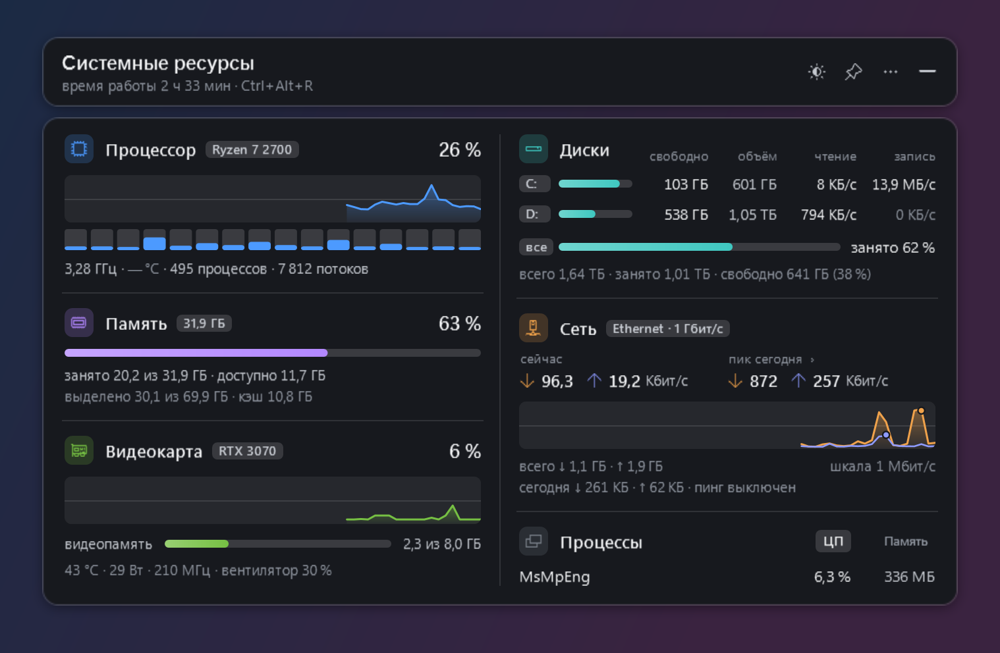
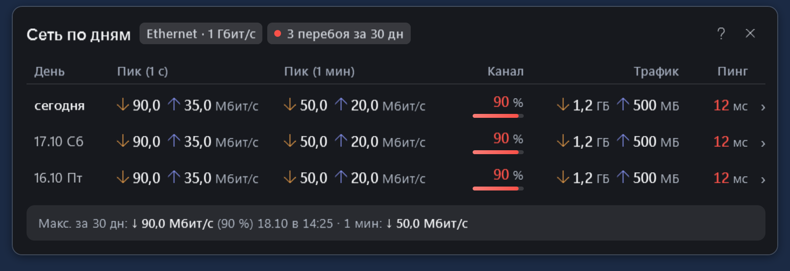
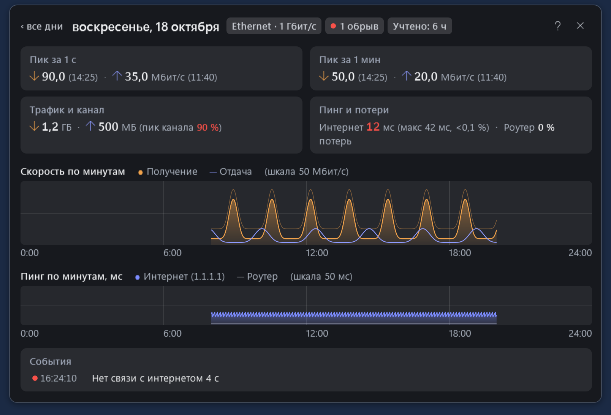
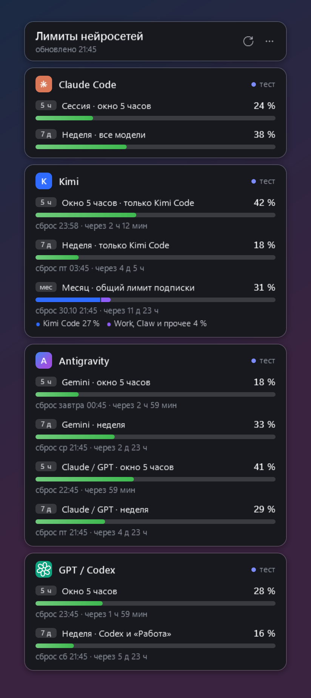

# Виджеты рабочего стола

[English](README.md) · [Страница проекта](https://nikolaykazakovvs-ux.github.io/desktop-widgets/) · [Скачать v0.1.0](https://github.com/nikolaykazakovvs-ux/desktop-widgets/releases/tag/v0.1.0)

Два самостоятельных виджета для Windows. **«Системные ресурсы»** показывает компьютер и ведёт подробный журнал сети. **«Лимиты нейросетей»** показывает запас подписок и время сброса. Их можно использовать независимо. Приложения написаны на C# с Windows Presentation Foundation (WPF); интерфейс сейчас на русском.

## Скачать и запустить

Первая публичная альфа коллекции — **v0.1.0**. Требования: **Windows 10/11 x64 и .NET Framework 4.8**. macOS и Linux планируются отдельно; исходников и загрузок для них пока нет.

| Приложение | Загрузка | Как начать |
| --- | --- | --- |
| Системные ресурсы 1.1.0 | [Установщик .exe](https://github.com/nikolaykazakovvs-ux/desktop-widgets/releases/download/v0.1.0/ResourcesWidgetSetup-1.1.0-x64.exe) | Откройте установщик; после установки появится карточка |
| Системные ресурсы 1.1.0 | [ZIP без установки](https://github.com/nikolaykazakovvs-ux/desktop-widgets/releases/download/v0.1.0/ResourcesWidget-1.1.0-win-x64.zip) | Распакуйте в папку с правом записи и откройте ResourcesWidget.exe |
| Лимиты нейросетей 1.0.0 | [ZIP](https://github.com/nikolaykazakovvs-ux/desktop-widgets/releases/download/v0.1.0/LimitsWidget-1.0.0-win.zip) | Распакуйте и откройте LimitsWidget.exe, затем включите нужные источники |

[Изменения, файлы и контрольные суммы SHA-256](https://github.com/nikolaykazakovvs-ux/desktop-widgets/releases/tag/v0.1.0). Приложения и установщик не подписаны: Windows может предупредить о неизвестном издателе. На управляемых компьютерах действуют правила организации.

Установщик ресурсов работает для текущего пользователя: принимает отдельную новую/пустую папку или подтверждённую прежнюю установку, создаёт ярлыки и запись для удаления. **Автозапуск включается по выбору.** Обновление сохраняет настройки и положение окна. Удаление убирает известные файлы приложения, сохраняя настройки, сетевой журнал и посторонние файлы. Этот первый публичный выпуск не содержит, не устанавливает, не запускает и не настраивает сторонние датчики или драйверы; используйте отдельно настроенные внешние источники.

Щелчок по значку в трее показывает и скрывает карточку. **Ctrl+Alt+R** — ресурсы, **Ctrl+Alt+L** — лимиты. В меню — темы, масштаб, прозрачность, закрепление, автозапуск и выход. Первый запуск не меняет видимость значка Windows и не включает автозапуск автоматически. Настройки и история пишутся рядом с приложением; для ZIP нужна доступная для записи папка. Повторный запуск может показать уже работающую копию того же виджета.

## Системные ресурсы

Для рабочего и домашнего ПК, в том числе поиска узких мест на старых машинах. Карточка показывает:

- **Процессор:** общую загрузку, каждый логический процессор, график, частоту и температуру при доступном датчике; число процессов и потоков.
- **Память:** занято, доступно, выделено, кэш.
- **Видеокарту:** загрузку, видеопамять и доступные показатели температуры, мощности, частоты и вентилятора.
- **Диски:** место, чтение и запись по дискам, общий итог.
- **Процессы:** самые нагруженные по процессору или памяти, с объединением одинаковых имён.
- **Сеть:** текущие скорости, пики, пинг, скорость соединения, дневной трафик и события.

[](docs/images/resources-card.png)

Реальный интерфейс и показания системы; дополнительные датчики зависят от оборудования и настройки. Нажмите на изображение для полного размера.

### Журнал сети

Щелчок по пикам открывает отдельное окно с днями. Для каждого дня: **краткий пик**, **максимум средней за минуту**, время пиков, процент номинала канала, трафик и средняя задержка. Подробности дня показывают поминутные графики скорости и пинга до внешнего узла и роутера, потери, время наблюдения и события:

- изменение скорости соединения адаптера, например 1 Гбит/с → 100 Мбит/с;
- отключение адаптера;
- несколько неответов внешнего узла с сопоставлением ответов роутера;
- длительный высокий пинг.

| Журнал по дням | Подробности дня |
| --- | --- |
| [](docs/images/network-journal.png) | [](docs/images/network-day.png) |

Реальный интерфейс приложения; демонстрационные обезличенные данные. История хранится локально в network-log: итоги по дням, поминутные CSV и события, до 400 дней.

**Границы измерений.** Учитывается этот ПК во время работы виджета, включая локальный сетевой обмен. Трафик других устройств не учитывается. Краткий пик зависит от интервала опроса (по умолчанию около секунды), минутный — максимум скользящей средней примерно за 60 секунд. Процент считается от заданного тарифа либо скорости адаптера и не измеряет доступную пропускную способность интернета. Он помогает оценивать наблюдаемую нагрузку, но сам по себе не определяет подходящий тариф.

Проверка связи включена: внешний узел по умолчанию **1.1.1.1**, шлюз определяется автоматически, интервал — 2 секунды. Пустой pingHost выключает проверки. Пинг использует Internet Control Message Protocol (ICMP); неответ может означать фильтрацию или ограничение ответов. Сравнение с роутером помогает диагностике, но не доказывает виновность провайдера, кабеля или роутера.

**Датчики и совместимость.** Для NVIDIA используется драйвер NVIDIA, для других GPU и запасного пути — Windows Display Driver Model (WDDM). Температуру CPU отдают совместимые внешние программы, включая HWiNFO, AIDA64, Core Temp и LibreHardwareMonitor. Клиент читает уже настроенный локальный LibreHardwareMonitor на 127.0.0.1:8085, сам сервер не запускает и не настраивает. Без внешнего источника температура недоступна. Пустой lhmUrl отключает этот опрос. В зависимости от оборудования и драйвера часть датчиков может быть недоступна.

Проверка пути WDDM выполнена на NVIDIA RTX 3070; AMD и Intel на реальном оборудовании отдельно не проверялись. Проверенной матрицы старых ПК нет: потребление памяти, CPU и температурного помощника нужно оценивать на целевой машине. [Сравнение с другими программами](docs/comparison.md).

## Лимиты нейросетей

Отдельная карточка Claude Code, Kimi Code, Antigravity и GPT / Codex: доступные окна лимитов, время сброса, кредиты и дополнительный расход, когда источник их возвращает. Предыдущий успешный снимок может показываться как устаревший после ошибки. Отсутствующие данные не превращаются в нулевой расход.

[](docs/images/limits-card.png)

Реальный интерфейс приложения; демонстрационные данные. Личные аккаунты на снимке не используются.

**Все провайдеры выключены по умолчанию**, в том числе при отсутствии конфига. После включения выбранный источник обновляется автоматически: по умолчанию раз в 300 секунд, минимум — 60 секунд. Войдите штатно через нужное приложение или интерфейс командной строки (CLI), затем включите только нужный services.<provider>.enabled в локальном config.json. Необязательный command задаёт установленную команду CLI. Секреты в конфиг не записываются.

| Провайдер | Реализованный источник |
| --- | --- |
| Claude Code | Установленный claude: get_usage в потоковом режиме, запасной /usage. При отсутствии входа CLI может читать локальный кэш расхода приложения Claude. Действие входа по запросу пользователя запускает авторизацию CLI. |
| GPT / Codex | codex app-server, запрос account/rateLimits/read; авторизацией управляет CLI. |
| Antigravity | agy /usage и /credits; требуется совместимый установленный CLI с его авторизацией. |
| Kimi Code | Локальный сервер приложения и его server.token для loopback-запроса. Этот серверный токен используется и при allowLocalTokens: false. При включении allowLocalTokens запасной путь читает OAuth access token из локальных файлов Kimi и отправляет его на настроенный endpoint; виджет не обновляет токен самостоятельно. |

allowLocalTokens ограничивает только прямой запасной путь Kimi, а не любой доступ к авторизации. Он выключен в поставке. Не назначайте недоверенный baseUrl: при таком запасном пути туда отправляется bearer token. Интеграции зависят от совместимости версий приложений провайдеров; это независимый проект.

## Данные и приватность

Настройки, снимки и журналы остаются рядом с приложениями. Ресурсы обращаются к выбранному узлу пинга и к локальному температурному помощнику; лимиты — к явно включённым источникам. Экспорт может содержать названия устройств, процессов, адаптеров, пути и историю активности; перед публикацией его нужно проверить и обезличить. Личные конфиги, аккаунты и журналы не входят в репозиторий или публичные архивы.

Страница проекта — статический HTML без аналитики, аккаунтных запросов и внешних шрифтов. На ней настоящие WPF-экспорты: ресурсы с показаниями системы, журнал и лимиты с контролируемыми демонстрационными данными.

## Для разработчиков

Исходники находятся в windows/resources-widget и windows/limits-widget. docs — статическая страница GitHub Pages, без сборщика. Сборка требует Windows PowerShell и компилятора .NET Framework 4.8; отдельный .NET SDK не нужен.

Вставить в Windows PowerShell из корня репозитория; исполнитель — разработчик или агент Codex:

```powershell
powershell -NoProfile -ExecutionPolicy Bypass -File .\windows\resources-widget\build.ps1
powershell -NoProfile -ExecutionPolicy Bypass -File .\windows\limits-widget\build.ps1
powershell -NoProfile -ExecutionPolicy Bypass -File .\windows\resources-widget\installer\build-setup.ps1
```

Скрипты сборки приложения не закрывают работающий виджет. Существующий config.json не перезаписывается. Установщик только виджета собирается из этих исходников без скачиваний и сторонних бинарных компонентов. Не проверяйте запросы к личным аккаунтам в обычных тестах. [Правила участия](CONTRIBUTING.md).

## Лицензии

Код проекта — [MIT](LICENSE), Copyright (c) 2026 Svetomir. Внешние интеграции описаны в [THIRD-PARTY.txt](windows/resources-widget/installer/payload/THIRD-PARTY.txt). Сторонние приложения сохраняют свои лицензии и в этот выпуск не включены. Связь с провайдерами или их одобрение не заявляются.
