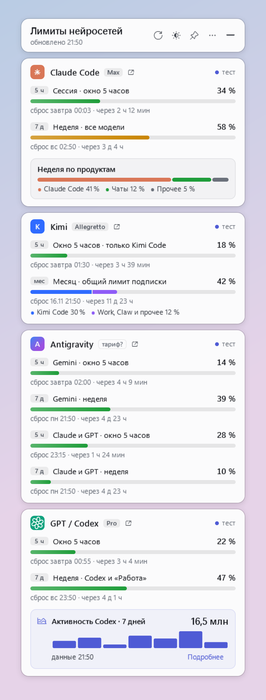

# Лимиты нейросетей 1.1.0 / AI Limits 1.1.0

[На главную (RU)](../README.ru.md) · [Main README (EN)](../README.md) · [Страница проекта](https://nikolaykazakovvs-ux.github.io/desktop-widgets/) · [Пререлиз v0.2.0](https://github.com/nikolaykazakovvs-ux/desktop-widgets/releases/tag/v0.2.0)

Самостоятельный десктоп-виджет для Windows 10/11 x64 (.NET Framework 4.8, C# 5 / WPF). Показывает подписочные окна использования, время сброса, кредиты, дополнительный расход и статистику токенов для **Claude Code**, **Kimi Code**, **Antigravity** и **GPT / Codex**.

[](images/limits-card.png)

*Реальный интерфейс приложения; контролируемые демонстрационные данные. Личные аккаунты на снимке не используются.*

---

## 1. Состав поставки v0.2.0 (`LimitsWidget-1.1.0-win-x64.zip`)

Публичный пререлиз **v0.2.0** относится только к виджету **«Лимиты нейросетей» 1.1.0** и содержит ровно два файла релиза:
- [`LimitsWidget-1.1.0-win-x64.zip`](https://github.com/nikolaykazakovvs-ux/desktop-widgets/releases/download/v0.2.0/LimitsWidget-1.1.0-win-x64.zip)
- `SHA256SUMS.txt` (контрольная сумма SHA-256 архива)

Виджет **«Системные ресурсы» 1.1.1** остаётся на опубликованном релизе [**v0.1.1**](https://github.com/nikolaykazakovvs-ux/desktop-widgets/releases/tag/v0.1.1) без изменения ссылок и контрольных сумм.

Внутри архива `LimitsWidget-1.1.0-win-x64.zip` в папке `limits-widget/` находятся ровно 7 проверенных файлов из белого списка (6 файлов пакета + `package-manifest.json`):

| Файл | Назначение | Режим при обновлении |
|---|---|---|
| `LimitsWidget.exe` | Приложение виджета (версия `1.1.0.0`, `ProductName = LimitsWidget`) | Заменяется (`replace`) |
| `config.json` | Шаблон настроек для первого запуска (`allowLocalTokens: false`, все сервисы `enabled: false`) | Создаётся только при отсутствии (`seed-if-missing`) |
| `config.example.json` | Эталонный публичный пример конфигурации | Заменяется (`replace`) |
| `LICENSE` | Лицензия MIT | Заменяется (`replace`) |
| `START-HERE.txt` | Краткая памятка по первому запуску и обновлению (RU/EN, версия `1.1.0`) | Заменяется (`replace`) |
| `update-limits-widget.ps1` | Обратимый скрипт установки и обновления с проверкой манифеста, штатным закрытием виджета и резервной копией | Заменяется (`replace`) |
| `package-manifest.json` | Манифест пакета (`version: "1.1.0"`, `releaseTag: "v0.2.0"`, размеры и SHA-256 всех 6 файлов поставки) | Записывается после проверки |

Личные `config.json`, `state.json`, журналы `widget.log`, пути к локальным программам, токены, учётные записи и сторонние бинарники CLI в архив никогда не включаются.

---

## 2. Шапка карточки, диалог «Подписки…» и ссылки профиля

В версии **1.1.0** заголовок каждой карточки провайдера объединяет:
1. **Значок и название сервиса** (`Claude Code`, `Kimi`, `Antigravity`, `GPT / Codex`).
2. **Бейдж тарифа/подписки** с подсказкой об источнике данных и приоритетом:
   - `manual` (вручную заданное значение `services.<id>.plan` или через диалог «Подписки…») > `provider` (подтверждённое поле ответа провайдера) > `unknown` (бейдж не домысливается).
   - Устаревший ручной ключ `services.<id>.plan` в `config.json` полностью сохранён.
3. **Отдельную ссылку на профиль/подписку (`profileUrl`)** и ссылку на страницу лимитов (`url`):
   - Нажатие открывает проверенную страницу `https://` в браузере; контекстное меню и диалог позволяют скопировать адрес ссылки.
   - Назначения `profileUrl` и `url` разделены: `profileUrl` ведёт на страницу управления аккаунтом/оплатой (а не на рекламный лендинг).
4. **Статус и время наблюдения**:
   - Внутреннее хранение всех меток времени — в **UTC**; перевод в местный часовой пояс выполняется только при отображении в интерфейсе.
   - Длинные названия тарифов аккуратно сокращаются многоточием; поддерживаются светлая и тёмная темы, компактный режим, масштабы 100 % / 150 % / 200 % и навигация с клавиатуры.

### Происхождение тарифа и ссылки по провайдерам

| Провайдер | Подтверждённое авто-поле тарифа | Страница лимитов (`url`) по умолчанию | Страница профиля/оплаты (`profileUrl`) по умолчанию |
|---|---|---|---|
| **Claude Code** | Только при наличии подтверждённого поля провайдера; иначе вручную через «Подписки…» | `https://claude.ai/settings/usage` | `https://claude.ai/settings/billing` |
| **Kimi Code** | Поле `userLevelName` из Server API отображается как уровень аккаунта (не выдаётся за платёжную квитанцию); тариф можно задать вручную | Задаётся при необходимости в «Подписки…» | Задаётся при необходимости в «Подписки…» |
| **Antigravity** | Только при наличии подтверждённого поля провайдера; иначе вручную через «Подписки…» | Задаётся при необходимости в «Подписки…» | `https://myaccount.google.com/payments-and-subscriptions` |
| **GPT / Codex** | Автоматически из подтверждённого `planType` (`account/rateLimits/read`), либо переопределяется вручную | `https://chatgpt.com/codex/settings/usage` | `https://chatgpt.com/#settings/Account` |

Нативный диалог **«Подписки…»** открывается из контекстного меню карточки или значка в трее и позволяет без ручного редактирования JSON включить нужные источники, выбрать автоматическое или ручное название тарифа и настроить ссылки `url` / `profileUrl`.

---

## 3. Источники данных и улучшения версии 1.1.0

Все четыре провайдера в публичной поставке **выключены по умолчанию** (`enabled: false`), а `allowLocalTokens` равен `false`. Виджет не выполняет сетевых или CLI-запросов, пока пользователь явно не включит выбранный сервис.

### GPT / Codex: подписочные квоты и 7-дневная статистика токенов
- **Окна квот:** опрашиваются через `codex app-server` (`account/rateLimits/read`), включая основной пул и дополнительные резервные лимиты.
- **Активность токенов за 7 дней (`account/usage/read`):**
  - Запрашивается в том же процессе `codex app-server` без `threadId` (на уровне аккаунта) с ограниченным бюджетом ожидания (не более 5 секунд оставшегося времени запроса).
  - Показывает суммарный расход токенов за 7 дней и столбики по дням, а в раскрывающемся блоке — `lifetimeTokens` (всего токенов), `peakDailyTokens` (пик за день), `currentStreakDays` (текущая серия дней), `longestStreakDays` (максимальная серия дней) и `longestRunningTurnSec` (самый долгий ход).
  - Сбой или отсутствие необязательной статистики токенов никогда не ломает отображение квот; `null`/пропуски не превращаются в `0`.
  - Статистика токенов имеет собственную метку времени `measuredAt` и не смешивается с процентами квот, историей кредитов или контрактом телеметрии `quotas-snapshot.json`.

### Kimi Code: работа без десктопного приложения и защита процессов
- **Перебор локальных серверов:** сборщик проверяет живые loopback-экземпляры из локального реестра Kimi в порядке свежести с ограниченным бюджетом перебора: отказ одного экземпляра не блокирует проверку следующего.
- **Собственный скрытый сервер `kimi web --no-open`:** если сервис Kimi включён (`services.kimi.enabled: true`), `startServer` разрешён (по умолчанию `true` для включённого сервиса) и ни один готовый локальный сервер не отвечает, виджет запускает собственный фоновый процесс `kimi web --no-open` без окна браузера и консоли, в отдельной временной рабочей папке, без создания LLM-сессий и с отбрасыванием стартового вывода, содержащего токен.
- **Строгие границы владения процессом:**
  - Чужие серверы Kimi (запущенные пользователем или десктопным приложением) переиспользуются и **никогда не останавливаются** виджетом.
  - Собственное дерево процесса `kimi web --no-open` останавливается при выходе из виджета или аварийном завершении (через Windows Job Object), но **не** при сворачивании карточки в трей; защита от шторма перезапусков предотвращает дубликаты.
- **Качество данных и авторизация:**
  - Значения `used` / `remaining` проверяются на конечность (`NaN`/`Infinity` и отношения вне допустимого диапазона отклоняются с сохранением прежнего достоверного снимка как `Stale`).
  - Пустые или отозванные записи токена распознаются как необходимость штатного входа через `kimi login` до сетевого запроса; виджет не модифицирует файлы авторизации Kimi самостоятельно.
  - Флаг `allowLocalTokens` по умолчанию `false` и управляет только прямым резервным запросом к `baseUrl`.

### Claude Code и Antigravity
- **Claude Code:** потоковый запрос `get_usage` с запасным `/usage` и чтением локального кэша десктопного приложения Claude. Модельные недельные окна (`model_scoped`) сохраняют типизированные метаданные подтверждённых пулов (`subscription.opus`, `subscription.sonnet`, `subscription.cowork`, `subscription.oauth_apps`); неподтверждённые подписи остаются только в UI со статусом `partial` и не угадываются как Opus. Отсутствующее поле `utilization` трактуется как неизвестное (`null`), а не `0 %`. Неизвестное исходное время наблюдения в `get_usage` остаётся `unknown` в телеметрии.
- **Antigravity:** запрос квот `/usage` отделён от запроса кредитов `/credits`. Кредиты используют отдельный 15-минутный кэш и 10-секундный таймаут, поэтому медленный ответ `/credits` не задерживает публикацию квот и не искажает их `measured_at`.

### Состояние, кэш и производительность
- Полная симметрия сохранения и чтения `ServiceSnapshot` в `state.json` (`url`, `profileUrl`, `plan`, `planSource`, `autoPlan`, `autoPlanSource`, `actionId`, `actionLabel`, `attention`, `activity`, `extras`, `bars`, `notes`).
- Последний успешный снимок (`cache` / last-good) хранится отдельно от записи о последней попытке (`attempts` / latest-attempt).
- Готовый результат каждого провайдера сразу передаётся в интерфейс и публикатор телеметрии, не дожидаясь медленных соседних источников; номер поколения (`Generation`) защищает новый опрос от перезаписи поздним ответом старого.
- Пока карточка скрыта в трее, дерево элементов WPF не перестраивается каждые 30 секунд (при этом расписание опросов, обновление значка трея и heartbeat телеметрии продолжают работать). Разрешённые пути CLI кэшируются до изменения `config.json` или `PATH`.

---

## 4. Обратимая установка, обновление и откат (`update-limits-widget.ps1`)

Скрипт `scripts/update-limits-widget.ps1` (также включённый внутрь архива `limits-widget/update-limits-widget.ps1`) выполняет безопасную установку или обновление существующей папки виджета:

1. **Проверка подлинности и изоляции до любых изменений:** требует явный локальный путь `-TargetPath` (отклоняет корни дисков, относительные и сетевые пути, системные/пользовательские корневые папки, папки с точками перенаправления NTFS / junction, рабочие копии Git и непустые посторонние каталоги). Для архива `.zip` проверяет контрольную сумму SHA-256 по явному параметру `-ExpectedPackageSha256` или по лежащему рядом `SHA256SUMS.txt`, проверяет отсутствие обхода путей (`..`) во всех записях архива, проверяет `package-manifest.json`, контрольные суммы SHA-256 всех файлов пакета и метаданные `LimitsWidget.exe` до остановки процесса или записи на диск.
2. **Штатное (graceful-only) завершение целевого процесса без принудительного снятия задач:** запрашивает штатный выход (`WM_CLOSE` окну целевого процесса и событие выхода одиночного экземпляра при отсутствии других копий) только у процесса `LimitsWidget.exe`, запущенного ровно из `<TargetPath>\LimitsWidget.exe` (проверяются PID, полный путь и время запуска). Посторонние копии `LimitsWidget.exe`, внешние программы, браузеры и CLI никогда не закрываются; принудительное завершение (`Stop-Process -Force` / `TerminateProcess`) не используется. Если целевой процесс не завершился штатно за `-GracefulStopTimeoutSeconds` (по умолчанию 10 с), обновление или откат прерывается **до внесения любых изменений** в `<TargetPath>`.
3. **Сохранность настроек и истории (включая запись при выходе и правки после обновления):** целевой виджет штатно завершается **до** снятия контрольных сумм и резервной копии, поэтому финальное сохранение `state.json` при закрытии окна не конфликтует с обновлением. Существующие `config.json` и `state.json` (включая все пользовательские и неизвестные поля) и посторонние пользовательские файлы сохраняются без изменений, в том числе при последующем откате `-RollbackFromBackup`.
4. **Безопасная архивация старых исходников:** если в обновляемой папке остались старые каталоги и скрипты прежней поставки (`src/`, `assets/`, `tools/`, `fixtures/`, `build.ps1`, `app.manifest`, `README.md`), они не удаляются, а переносятся в `<TargetPath>\.limits-widget-legacy\legacy-<timestamp>\`.
5. **Резервная копия и автоматический откат:** перед обновлением создаётся полный снимок в `<TargetPath>\.limits-widget-backups\backup-<timestamp>\` с привязкой к конкретному `targetPath` (чужую резервную копию нельзя применить к другой папке). При любой ошибке во время обновления состояние папки автоматически восстанавливается из резервной копии.

### Команды PowerShell

Разместите `SHA256SUMS.txt` рядом с `LimitsWidget-1.1.0-win-x64.zip` (либо передайте `-ExpectedPackageSha256 "<sha256>"`).

Проверка без внесения изменений (`-DryRun`):

```powershell
powershell -NoProfile -ExecutionPolicy Bypass -File .\scripts\update-limits-widget.ps1 `
  -TargetPath "D:\Apps\limits-widget" `
  -PackagePath ".\LimitsWidget-1.1.0-win-x64.zip" `
  -DryRun
```

Изолированная распаковка с проверкой манифеста и хешей (`-ExtractTo`, без установки):

```powershell
powershell -NoProfile -ExecutionPolicy Bypass -File .\scripts\update-limits-widget.ps1 `
  -PackagePath ".\LimitsWidget-1.1.0-win-x64.zip" `
  -ExtractTo "D:\Temp\limits-widget-extracted"
```

Обратимое обновление установленной копии:

```powershell
powershell -NoProfile -ExecutionPolicy Bypass -File .\scripts\update-limits-widget.ps1 `
  -TargetPath "D:\Apps\limits-widget" `
  -PackagePath ".\LimitsWidget-1.1.0-win-x64.zip"
```

Откат к последней резервной копии (`-RollbackFromBackup`):

```powershell
powershell -NoProfile -ExecutionPolicy Bypass -File .\scripts\update-limits-widget.ps1 `
  -TargetPath "D:\Apps\limits-widget" `
  -RollbackFromBackup latest
```

Сборка и полная офлайн-проверка пакета из корня репозитория:

```powershell
powershell -NoProfile -ExecutionPolicy Bypass -File .\scripts\build-limits-release.ps1 -OutputDirectory .\artifacts\limits-release
powershell -NoProfile -ExecutionPolicy Bypass -File .\scripts\test-limits-release.ps1 -ArtifactsDirectory .\artifacts\limits-release -ResultsDirectory .\artifacts\limits-test-results
```

---

## 5. Черновик описания релиза / Release Notes Draft (`v0.2.0` — AI Limits 1.1.0)

### Русский (RU)

**Пререлиз `v0.2.0` — Лимиты нейросетей 1.1.0 (`LimitsWidget-1.1.0-win-x64.zip`)**

Этот выпуск обновляет только виджет **«Лимиты нейросетей»** до версии **1.1.0**. Виджет **«Системные ресурсы» 1.1.1** остаётся в релизе [`v0.1.1`](https://github.com/nikolaykazakovvs-ux/desktop-widgets/releases/tag/v0.1.1).

- **Шапка карточек и диалог «Подписки…»:** бейдж тарифа с подсказкой источника (`вручную > подтверждённое поле провайдера > неизвестно`), отдельные ссылки на страницу лимитов (`url`) и страницу аккаунта/оплаты (`profileUrl`) с возможностью открытия и копирования, нативный диалог настройки подписок и источников.
- **GPT / Codex:** статистика использования токенов за 7 дней и по дням (`account/usage/read` в том же процессе `app-server`, без `threadId`, бюджет до 5 с) с раскрываемыми показателями `lifetimeTokens`, `peakDailyTokens`, `currentStreakDays`, `longestStreakDays`, `longestRunningTurnSec`. Не смешивается с подписочными квотами и телеметрией; пропуски не превращаются в ноль.
- **Kimi Code без десктопного приложения:** перебор доступных локальных loopback-серверов и опциональный запуск собственного фонового `kimi web --no-open` без браузера и консольного окна. Чужие серверы сохраняются; собственное дерево процессов завершается при выходе из виджета. Отклонение некорректных долей (`NaN`, `Infinity`, вне `0..1`) и пустых отозванных токенов; явное действие входа через `kimi`.
- **Точность состояния и времени:** хранение времени в UTC с локализацией в UI, полный roundtrip полей `ServiceSnapshot` в `state.json`, раздельные `cache` (last-good) и `attempts` (latest-attempt), сохранение типизированных пулов для модельных окон Claude (`model_scoped`) без превращения отсутствующего `utilization` в `0 %`.
- **Производительность:** немедленная публикация результата каждого провайдера по мере готовности, отдельный 15-минутный кэш кредитов Antigravity, пропуск перестройки дерева WPF при свёрнутой в трей карточке и кэш разрешения путей CLI.
- **Обратимое обновление:** в архив добавлены `package-manifest.json` и `update-limits-widget.ps1` с проверкой SHA-256 архива и файлов до изменений, штатным (graceful-only) закрытием только целевого `LimitsWidget.exe` без принудительного снятия задач, сохранением `config.json`/`state.json` (включая неизвестные поля и пользовательские правки при откате), архивацией старых `src`/`build.ps1` и откатом из резервной копии. Все провайдеры по умолчанию выключены (`enabled: false`, `allowLocalTokens: false`).

### English (EN)

**Prerelease `v0.2.0` — AI Limits 1.1.0 (`LimitsWidget-1.1.0-win-x64.zip`)**

This prerelease ships **AI Limits 1.1.0** (`LimitsWidget-1.1.0-win-x64.zip` + `SHA256SUMS.txt`). **System Resources 1.1.1** remains unchanged at [`v0.1.1`](https://github.com/nikolaykazakovvs-ux/desktop-widgets/releases/tag/v0.1.1).

- **Card headers & native Subscriptions dialog:** subscription badge with provenance tooltip (`manual > confirmed provider field > unknown`), separate quota (`url`) and verified account/billing (`profileUrl`) links with copy support, and a native Subscriptions dialog.
- **GPT / Codex 7-day token activity:** account-wide `account/usage/read` over the same `codex app-server` process (bounded 5s budget) showing 7-day and daily token buckets plus expandable `lifetimeTokens`, `peakDailyTokens`, `currentStreakDays`, `longestStreakDays`, and `longestRunningTurnSec`. Kept separate from quota/credit telemetry; missing values remain unknown rather than zero.
- **Kimi Code headless loopback support:** probes live loopback candidates from the local registry with bounded fallback, and can launch an owned headless `kimi web --no-open` server when enabled and no server is running. Reuses and never stops foreign servers; terminates only its own server process tree on widget exit. Rejects invalid/NaN usage ratios and revoked/empty token files; delegates authentication to native `kimi`.
- **State, UTC & Claude scoped windows:** UTC persistence with local-time UI rendering, full `ServiceSnapshot` cache roundtrip, separate `lastGood` (`cache`) and `latestAttempt` (`attempts`) records, and typed quota metadata for confirmed Claude model-scoped windows while keeping missing `utilization` unknown rather than `0%`.
- **Performance:** immediate per-provider UI and telemetry publication with generation guards, decoupled Antigravity `/credits` cache (15 min TTL / 10s timeout), skipped WPF visual tree rebuilds while hidden to the tray, and invalidated CLI path caching.
- **Reversible graceful updater (`update-limits-widget.ps1` & `package-manifest.json`):** verifies archive SHA-256 (`-ExpectedPackageSha256` or adjacent `SHA256SUMS.txt`), manifest, and per-file hashes before mutation, requests graceful-only exit of the exact target `LimitsWidget.exe` (never force-killing processes or external apps/browsers, and aborting before mutation if graceful stop cannot be confirmed), preserves `config.json` and `state.json` (including unknown fields and post-update edits across rollback), safely archives legacy `src/` and `build.ps1`, and supports `-DryRun`, `-ExtractTo`, and `-RollbackFromBackup`. All providers remain disabled by default (`allowLocalTokens: false`).
