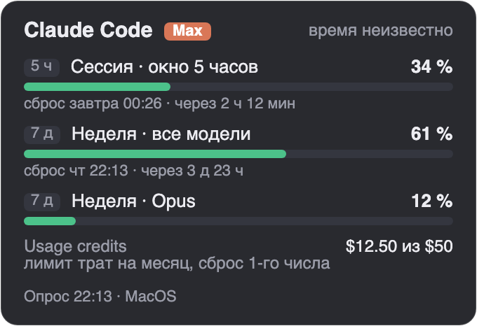

# Кроссплатформенный прототип «Лимитов» (Avalonia)

Статус: **прототип для решения о полном переносе**. Работающая WPF-версия в `windows/limits-widget` не изменена и остаётся основной. Прототип не входит в выпуски.

Одно приложение на C# / .NET 10 / Avalonia 12.1.5 для Windows, macOS и Linux. Один реальный провайдер — **Claude Code**: тот же порядок опроса, что в WPF-версии (`get_usage` через stream-json → `claude -p "/usage"` → история приложения Claude при отсутствии входа).



Настоящий рендер приложения на macOS 26.2. Данные тестовые (`fixtures/claude-get-usage.json`).

## Устройство

| Проект | Что внутри | Зависимости от ОС |
|---|---|---|
| `Limits.Core` | Модели, JSON (формат WPF байт в байт), разбор ответов Claude, проекция в контракт `quotas-snapshot` 1.0.0, геометрия размещения на мониторах, интерфейсы (`Ports.cs`) | Нет |
| `Limits.Platform` | Пути ОС, поиск и запуск CLI, писатели снимка (Windows — ACL, macOS/Linux — права POSIX), детектор сна | Выбор во время выполнения |
| `Limits.App` | Окно-карточка, значок в трее или строке меню, самопроверка `--selftest` | Avalonia |
| `Limits.Tests` | 33 теста xUnit v3 | Платформенные тесты идут на той ОС, где запущены |

Ядро не запускает процессы и не знает путей ОС. Всё это приходит через `IProcessRunner`, `ITelemetrySink` и `IAppPaths`.

## Контракт с Bridge и S.I.G.M.A.

- **Формат файла не изменился.** `QuotasProjection` перенесён из `TelemetryPublisher.cs` без изменений логики: те же поля, порядок ключей, статусы и запрет экспорта подписей, тарифа и данных аккаунта. Снимки прототипа проходят `telemetry/tests/contract.py` — тот же валидатор, что у WPF-версии.
- **Каталог выбирается как в контракте:** `--telemetry-dir` → `DESKTOP_WIDGETS_TELEMETRY_DIR` → стандартный каталог.
  - На Windows стандартный каталог прежний: `%LOCALAPPDATA%\DesktopWidgets\telemetry`.
  - На macOS — `~/Library/Application Support/DesktopWidgets/telemetry`, на Linux — `$XDG_STATE_HOME/DesktopWidgets/telemetry`. Это **предложение**: в контракте пути для macOS и Linux пока не описаны.
- **Защита файла.** Windows — копия ACL-писателя на API .NET 10. macOS/Linux:
  - каталог 0700, файл 0600, владелец — текущий пользователь;
  - символьные ссылки не допускаются;
  - запись атомарная: временный файл (`O_EXCL`), `fsync` и `rename(2)`;
  - один writer на файл через `flock`;
  - fixture-режим не пишет в живой каталог.
- **Особенность, перенесённая из WPF без изменений.** `get_usage` не сообщает время наблюдения, поэтому окна Claude из этого пути публикуются как `unknown`, а провайдер — как `partial`. Проценты с неподтверждённым временем в телеметрию не попадают.

## Проверено на macOS (MacBook Pro, Apple Silicon, macOS 26.2), 08.11.2026

Самопроверка в реальном окне — `scripts/selftest-unix.sh`, с настоящим `claude` 2.1.319:

| Проверка | Итог | Подробности |
|---|---|---|
| Запуск CLI | ✅ | `claude` найден в `~/.local/bin`; `get_usage` за 1,2–1,8 с; тариф из `auth status --json` |
| Окно | ✅ | Без рамки, перетаскивание, «поверх окон» включается и выключается, правый верхний угол рабочей области |
| Трей (строка меню) | ✅ | Значок и меню из 5 пунктов; показ и скрытие карточки; приложение не появляется в Dock |
| Мониторы | ✅ частично | Позиция на отключённом мониторе возвращается в видимую область; размер считается в координатах экрана (`DesktopScaling`), а не Retina-пикселях. Настоящий второй монитор не проверялся — у Mac один дисплей; логика покрыта тестами (отрицательные координаты, окно на двух мониторах, отключение) |
| Сон и пробуждение | ✅ имитация | Процесс заморожен на 40 с (`SIGSTOP`): пробуждение обнаружено, выполнен повторный опрос. Настоящий сон Mac не включался: удалённый доступ к машине мог пропасть |
| Телеметрия | ✅ | `quotas-snapshot.json` с правами 0600 в каталоге 0700, проходит валидатор контракта |
| Тесты | ✅ | 33 из 33 |

### Память и размер (macOS arm64)

| Сборка | Объём на диске (ZIP) | phys_footprint* | RSS |
|---|---|---|---|
| Framework-dependent (`dotnet LimitsXplat.dll`) | — (нужен .NET 10) | 85–91 МБ | 145–172 МБ |
| Self-contained | 111 МБ (43 МБ) | — | — |
| Self-contained + trimming (обрезка неиспользуемого кода) | 45 МБ (19 МБ) | **72 МБ** | 143–148 МБ |

\* phys_footprint — то, что показывает «Мониторинг системы»; RSS (Resident Set Size — резидентная память) включает общие системные библиотеки. Управляемая куча — 2,5–2,8 МБ, то есть почти всё занимают движок отрисовки Skia, рантайм и шрифты.

Self-contained + trimming для Windows x64 без `.pdb` — 45 МБ (ZIP 20 МБ). Сравнения с WPF на одной машине нет: WPF не запускается на Mac.

## Windows и Linux

Здесь сборки не запускались. Готовый CI лежит в `xplat/ci/xplat-ci.yml`. Он не в `.github/workflows/`: у токена агента нет права `workflow` на изменение workflow-файлов, поэтому перенести его туда должен владелец репозитория. CI выполняет на `windows-latest`, `macos-latest` и `ubuntu-latest`:

- сборку;
- тесты, включая перенесённый Windows-писатель с ACL;
- проверку контракта;
- самопроверку окна и трея на тестовых данных. На Linux она под Xvfb и информационная: трею нужен StatusNotifier host.

## Что потребуется адаптировать при полном переносе

**Обязательно**

1. **Общий писатель телеметрии.** `Limits.Platform/WindowsTelemetryWriter.cs` — временная копия `telemetry/publisher-shared/TelemetrySnapshotWriter.cs`. Нужен один файл с `#if NETFRAMEWORK` или полный переход WPF на .NET 10.
2. **Пути macOS и Linux в контракт.** Согласовать стандартный каталог с Bridge и S.I.G.M.A. и вписать его в `docs/ai-telemetry-contract.md`. Сейчас контракт описывает только `%LOCALAPPDATA%`.
3. **Остальные провайдеры.** Codex (`codex app-server`), Kimi (локальный сервер, реестр экземпляров, свой `kimi web`), Antigravity (`agy`, `/credits`). Пути их файлов и реестров на macOS и Linux нужно найти и проверить на реальных установках.
4. **Лимит процессов.** Windows Job с `maxProcesses` (ограничивает `agy`) не перенесён. На macOS/Linux аналога нет: нужны группа процессов, `setrlimit(RLIMIT_NPROC)` или отказ от лимита. Сейчас дерево завершается целиком по тайм-ауту.
5. **UI.** Перенести всю карточку: статистику Codex, всплывающее окно активности, диалог «Подписки…», ссылки, кнопку входа, темы, масштаб, прозрачность и закрепление. В прототипе — только просмотр Claude.
6. **Горячая клавиша** `Ctrl+Alt+L`. Глобальных горячих клавиш в Avalonia нет: на Windows — `RegisterHotKey`, на macOS — Carbon `RegisterEventHotKey` или `NSEvent` monitor (нужно разрешение «Универсальный доступ»), на Linux — зависит от окружения.
7. **Автозапуск.** Windows — реестр `Run`, macOS — LaunchAgent или `SMAppService`, Linux — `~/.config/autostart`.
8. **Поставка и подпись.**
   - macOS: `.app`-бандл (`Info.plist`, `LSUIElement`), подпись Developer ID и нотаризация — иначе Gatekeeper блокирует запуск. Для этого нужен Apple Developer Program.
   - Windows: ZIP и установщик, скрипт обновления `update-limits-widget.ps1` с проверкой SHA-256 под новую структуру файлов.
9. **Конфиг и состояние.** Прототип хранит `state.json` отдельно (`…/DesktopWidgets/limits-xplat`). Нужна миграция `config.json` и `state.json` WPF-версии с сохранением неизвестных полей.
10. **Тесты WPF-версии.** Перенести `windows/limits-widget/tests` (Fake CLI, сценарии провайдеров) на xUnit.

**Желательно**

11. **Сон.** Сейчас пробуждение определяется по разрыву часов, задержка — до 5 с. Нативные события (`WM_POWERBROADCAST`, `NSWorkspaceDidWakeNotification`, logind) дадут мгновенную реакцию.
12. **Иконка строки меню на macOS.** Нужно монохромное template-изображение вместо цветного `.ico`.
13. **Проверки на реальном оборудовании.**
    - Windows: несколько мониторов с разным масштабом (100 %/150 %), настоящий сон.
    - macOS: внешний монитор, Spaces и полноэкранные приложения, настоящий сон.
    - Linux: GNOME (трей только через расширение) и KDE.
14. **Память.** Около 72 МБ на macOS — в основном Skia и рантайм. Резервы: Native AOT (компиляция в машинный код заранее, требует проверки совместимости с Avalonia) и отключение неиспользуемых шрифтов.

## Запуск

```bash
# .NET 10 SDK: https://dot.net (на Mac без прав администратора: dotnet-install.sh --install-dir ~/.dotnet)
dotnet build xplat/Limits.Xplat.sln -c Release
dotnet run --project xplat/Limits.Tests -c Release            # тесты
dotnet xplat/Limits.App/bin/Release/net10.0/LimitsXplat.dll    # приложение с настоящим claude
# тестовые данные и отдельный каталог телеметрии:
dotnet xplat/Limits.App/bin/Release/net10.0/LimitsXplat.dll --fixture-usage xplat/fixtures/claude-get-usage.json --telemetry-dir /tmp/tele
# самопроверка с имитацией сна:
xplat/scripts/selftest-unix.sh /tmp/st --telemetry-dir /tmp/tele
```

Аргументы: `--telemetry-dir`, `--config-dir`, `--claude-command <путь>`, `--refresh-seconds` (минимум 60), `--fixture-usage <файл>`, `--selftest <каталог>`, `--selftest-seconds`.
